<a href="#"><picture><source media="(prefers-color-scheme: dark)" srcset="assets-bundle/assets/header-dark.svg"></picture></a>

<a href="https://portfolio-delta-ruby-59.vercel.app/"><picture><source media="(prefers-color-scheme: dark)" srcset="assets-bundle/assets/btn-portfolio-dark.svg"></picture></a>
<a href="https://www.linkedin.com/in/pruthvi-bijjarapu29"><picture><source media="(prefers-color-scheme: dark)" srcset="assets-bundle/assets/btn-linkedin-dark.svg"></picture></a>
<a href="https://leetcode.com/u/pruthvi_2911/"><picture><source media="(prefers-color-scheme: dark)" srcset="assets-bundle/assets/btn-leetcode-dark.svg"></picture></a>
<a href="mailto:pruthvibijjarapu2911@gmail.com"><picture><source media="(prefers-color-scheme: dark)" srcset="assets-bundle/assets/btn-email-dark.svg"></picture></a>

## ✦ about

I like taking things that feel clunky and making them simpler, whether that's a screen, an API or a messy dataset. Most of what's here started as *"wait, could I build that?"* Some of it worked. The rest taught me more by not working.

Lately I'm spending my time on RAG, agents, and figuring out how to make AI actually useful inside real products.

## ✦ things i've built

<a href="https://github.com/Pruthvi2911/DarkStore-AI"><picture><source media="(prefers-color-scheme: dark)" srcset="assets-bundle/assets/p01-dark.svg"></picture></a>
<a href="https://github.com/Pruthvi2911/Smart-Attendance"><picture><source media="(prefers-color-scheme: dark)" srcset="assets-bundle/assets/p02-dark.svg"></picture></a>

<a href="https://github.com/Pruthvi2911/JobSense"><picture><source media="(prefers-color-scheme: dark)" srcset="assets-bundle/assets/p03-dark.svg"></picture></a>
<a href="https://github.com/Pruthvi2911?tab=repositories"><picture><source media="(prefers-color-scheme: dark)" srcset="assets-bundle/assets/p04-dark.svg"></picture></a>

## ✦ stuff i work with

<a href="#stack"><picture><source media="(prefers-color-scheme: dark)" srcset="assets-bundle/assets/stack-dark.svg"></picture></a>

 

<a href="#end"><picture><source media="(prefers-color-scheme: dark)" srcset="assets-bundle/assets/marquee-dark.svg"></picture></a>
